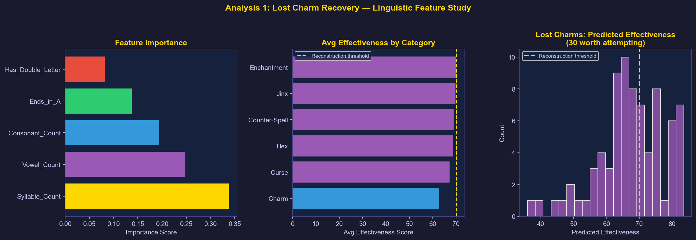
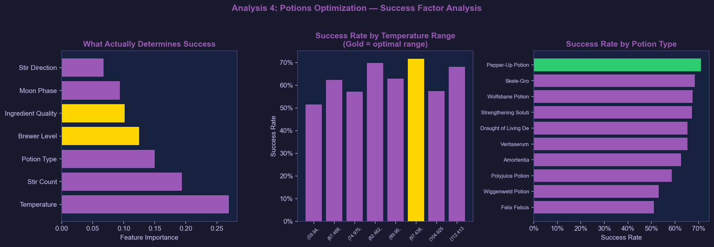

# The Pembrook Papers: Muggle Analytics Applied to Magical Problems
### A Private Research Initiative — *This Repository Does Not Exist*


---

## About the Analyst

**Reginald Pembrook**, Senior Archivist  
Department of Magical Records, Ministry of Magic, Whitehall  
Ravenclaw, Class of 1991  
Wand: Sycamore & Unicorn Hair, 14 inches, Very Flexible

*"The sycamore makes a questing wand, eager for new experience and losing brilliance if engaged in mundane activities."* — Garrick Ollivander

On 14 March 2019, a Muggle-born intern left a laptop in the Ministry break room. Pembrook's wand had nearly combusted twice that month from filing Floo Network usage reports. Fourteen hours later, he had installed Python and written his first for loop. His wand glowed warmly for the first time in eleven years.

This notebook is the result of five years of unauthorized cross-disciplinary research, conducted behind a Glamour Charm. The charm held. The models were less cooperative. The scores below are the ones the notebook actually printed.

---

## What This Project Actually Demonstrates

Behind the wizarding-world framing, this is a portfolio of five analyses on synthetic logs. The questions are whimsical. The scores are the holdout scores.

| Analysis | Magical Question | What was fit |
|---|---|---|
| 1. Lost Charm Recovery | Can linguistic structure predict spell effectiveness? | Random Forest regression, feature importance |
| 2. Herbology Clustering | Do magical plants group by functional property? | K-Means (k chosen as 4), StandardScaler, elbow plot |
| 3. Dark Arts Detection | Where do incident counts leave the usual range? | Monthly counts, z-score flags, province totals |
| 4. Potions Optimization | Which brewing fields does a classifier split on? | Random Forest classification, group success rates |
| 5. Alchemy Modeling | Once "None" is kept as a category, what does logistic regression catch? | Logistic regression, stone and level rates |

The saved notebook kernel is Python 3.13. The CSVs sit in the repository root, which is where the notebook reads them.

---

## Key Findings

Numbers below come from the executed notebook (`pembrook_magical_analytics.ipynb`) and, where a printed table skipped rows, from the same CSVs the notebook loads. A dull result is still a result. Pembrook has filed several.

### 1. Lost charms — the forest loses to the average

On the recovered manuscripts (172 of 250; 78 are lost), a random forest predicting `Effectiveness` from syllable count, vowel count, consonant count, a terminal "a", and a doubled letter scores:

- **R² = −0.244**
- **Mean absolute error = 14.2** effectiveness points

R² compares a model with a very plain baseline: ignore every feature and always guess the average outcome. Zero means the model tied that baseline. A negative R² means the predictions are worse than the average. This forest is less accurate than predicting the mean. It is a finding about these features on this split, and it is the score in the notebook.

The forest still ranks the splits it made. That ranking is how the trees divided the training rows, and with a negative R² it is a poor guide to what will work on a damaged manuscript:

| Feature | Importance |
|---|---|
| Syllable count | 0.338 |
| Vowel count | 0.248 |
| Consonant count | 0.195 |
| Ends in "a" | 0.137 |
| Doubled letter | 0.082 |

Syllable count leads. A terminal "a" is fourth. On the recovered rows themselves the linear associations agree about the order and add a direction: syllable count correlates about **−0.40** with effectiveness, vowel count about **+0.27**, and ending in "a" about **+0.25** (mean 74.2 when it ends in "a", 65.7 otherwise). The hints are in the ledger. They do not survive the holdout.

The same model still labels **30 of 78** lost charms at a predicted effectiveness of 70 or higher (an earlier draft of this page said 28). Those thirty are the model's own scores. Given R² = −0.244, they are a list of opinions, and the curse-breaker can stay home.



*The chart title says "30 worth attempting." Read that as "30 scored at or above 70 by a model that loses to the mean." Syllable count is the long bar.*

### 2. Herbology — four named groups, and potency does not track toxicity

K-means was fit at **k = 4** because the code picks four ("the magical number"). The elbow is plotted and the inertias are left on the chart. The four names are then handed out by sorting clusters on average potency, from low to high: Benign & Common, Lunar-Sensitive, High Potency / Dangerous, Rare & Complex. They are labels for that ranking.

| Cluster (potency rank) | Plants | Avg potency | Avg toxicity | Avg lunar sensitivity |
|---|---:|---:|---:|---:|
| Benign & Common | 8 | 0.38 | 0.20 | 0.28 |
| Lunar-Sensitive | 10 | 0.53 | 0.13 | 0.43 |
| High Potency / Dangerous | 2 | 0.66 | 0.78 | 0.32 |
| Rare & Complex | 10 | 0.85 | 0.11 | 0.50 |

The two-plant group is Aconite and Belladonna: fairly potent, and toxic. The highest-potency group is the least toxic of the four (0.11), and its lunar average (0.50) sits above the group that was named Lunar-Sensitive (0.43). Across all 30 plants, magical potency and toxicity correlate at about **r = −0.02**. A pair of poisonous ingredients is real. A general rule that power and poison travel together is absent from this table.

### 3. Dark arts — the surge is in the counts; the six-month head start is not in the run

The log holds **2,777** incidents across **420** months, 1990–2024. A month is flagged when its incident count sits more than **2.5** standard deviations above the mean of the whole series: **16 months (3.8%)**. Every flagged month falls between February 1995 and September 1998. The busiest is April 1998, with 22 incidents and z = 3.9.

Annual totals tell the same story without a threshold. The early 1990s sit around 50–65 incidents a year. Then:

| Year | Incidents |
|---|---:|
| 1995 | 170 |
| 1996 | 169 |
| 1997 | 164 |
| 1998 | 197 |

The z-score uses the mean and spread of the entire 1990–2024 archive, so it is a lantern shone backward over a finished record. It lights up months inside the surge. The notebook prints a hope that this would have beaten the Ministry's owl post by about six months. The run does not measure a lead time, and it does not compare itself to any owl-post series. February 1995 is the first flagged month, which is the surge arriving.

2024 has **90** incidents, in the company of 2019–2023 (88 to 105 a year) and above the quiet years of the 2000s. No month in 2023 or 2024 crosses z = 2.5. The recent years are a higher plateau. They are a different shape from 1995–98.

### 4. Potions — temperature and stir count lead the splits

A random forest classifier on 500 brewing attempts, scored on a 100-row holdout (64 successes, 36 failures):

- **Accuracy 67%**
- Failure: precision 0.58, recall 0.31, f1 0.40
- Success: precision 0.69, recall 0.88, f1 0.77

Guessing "success" for every test row would have scored **64%** on this split, because 64 of the 100 rows succeeded. The forest is three points above that. It finds most successes and misses most failures.

Importance, largest share first:

| Feature | Importance |
|---|---:|
| Temperature | 0.269 |
| Stir count | 0.193 |
| Potion type | 0.150 |
| Brewer level | 0.125 |
| Ingredient quality | 0.101 |
| Moon phase | 0.094 |
| Stir direction | 0.068 |

Temperature and stir count lead. Brewer level plus ingredient quality is **0.226** of the importance, about a quarter of the splits. The group averages still move a great deal, which is a different fact from the importance ranking:

| Brewer level | n | Success |
|---|---:|---:|
| Master | 91 | 84.6% |
| Auror | 108 | 70.4% |
| NEWT | 155 | 61.3% |
| Student | 146 | 45.9% |

| Ingredient quality | n | Success |
|---|---:|---:|
| Exceptional | 72 | 79.2% |
| Good | 173 | 66.5% |
| Standard | 198 | 57.6% |
| Poor | 57 | 50.9% |

Skill and ingredients show up when you average the log. They are the fourth and fifth things the forest splits on.

Temperature's own correlation with success is about **0.08**. In the eight equal-width bins drawn on the chart, the highest success rate is the bin from about **97°C to 105°C** (about 72%, 81 attempts). The coolest bin, about **60°C to 67°C**, sits near **52%**. Stir count is the second split and has a weak raw correlation with success (about 0.03); more stirs are not a straight climb. Stir direction, which the classroom argues about, is last: alternating 67.1% (n = 167), clockwise 62.6% (n = 171), counter-clockwise 59.3% (n = 162).



*The gold temperature bar is the bin with the highest rate in that chart, near 97–105°C. Brewer level and ingredient quality are the shorter gold bars, behind temperature, stir count, and potion type.*

### 5. Alchemy — 82% accuracy, and no successes found

The word `None` in the alchemy log means no Philosopher's Stone. It is on **201 of 300** rows. The notebook now loads that file with `keep_default_na=False`, so pandas keeps `None` as a category. A default read treats that word as a missing value. The group-by then skips those rows, which is why an earlier run printed an empty "no stone" table.

The logistic regression had still been given those rows, under a blank code that sorted last. This model treats the stone code as a single number, so naming the category `None` also moves that number (it now sits between Genuine and Partial). Refit on the corrected column, the same split prints:

| Class | Precision | Recall | F1 | Support |
|---|---:|---:|---:|---:|
| Failure | 0.82 | 1.00 | 0.90 | 49 |
| Success | 0.00 | 0.00 | 0.00 | 11 |
| Accuracy | | | | **0.82** |

Success recall is zero. None of the 11 successes in the holdout are predicted. Always predicting failure scores 49/60, which is this same **82%**. The earlier 85% score, and the two successes it caught, belonged to the run that stored the blank code at the end of the scale.

The stone table now includes the missing category:

| Stone | Success | Attempts |
|---|---:|---:|
| Genuine | 75.0% | 16 |
| None | 17.9% | 201 |
| Partial | 24.1% | 54 |
| Replica | 24.1% | 29 |

And the "no stone" table prints:

| Alchemist level | Success | Attempts |
|---|---:|---:|
| Apprentice | 3.2% | 63 |
| Journeyman | 17.4% | 69 |
| Adept | 14.3% | 42 |
| Grand Master | 59.3% | 27 |

Grand Masters with no stone succeed **59.3%** of the time (27 attempts). Apprentices with a genuine stone succeed **75.0%** (4 attempts). The apprentice cell is four tries. It sits above the Grand Masters who have no stone, and it will not carry a symposium.

Across every stone, skill still climbs with rank:

| Alchemist level | n | Success |
|---|---:|---:|
| Apprentice | 91 | 5.5% |
| Journeyman | 100 | 16.0% |
| Adept | 65 | 27.7% |
| Grand Master | 44 | 65.9% |

A genuine stone coincides with a 75% success rate across 16 attempts of every rank. Partial and replica stones sit near 24%. Skill moves the rate. The stone, in the genuine rows, moves it too. The refit model does not recognize a success at all.

---

## Why This Project Exists

Every portfolio has a data cleaning project. Every portfolio has a churn analysis. This one has a Ravenclaw archivist who taught himself the workflow because his wand was about to combust from boredom, and who then wrote down the scores the models actually earned.

The methods ran. The datasets are synthetic, historically flavored, and already in the repository. The wizard is fictional.

The skill on display is the rest of the workflow — loading the tables, building features, fitting a model, reading the evaluation, and saying plainly when the evaluation is dull. A negative R², a classifier three points above the majority class, and a correlation of about zero are allowed to stay on the page. Hiding them would be a different kind of glamour charm.

---

## Technical Stack

```
Python 3.13 (kernel recorded in the notebook)
pandas, NumPy — data manipulation
scikit-learn — RandomForestRegressor, RandomForestClassifier,
               KMeans, LogisticRegression, StandardScaler
matplotlib, seaborn — visualization (dark theme throughout)
```

---

## Files

The analysis lives at the repository root. There is no `data/` directory, and `generate_data.py` is not in this repository. The CSVs are the inputs the notebook already loads. Please do not wait for a generator script that was never committed.

```
.
├── README.md
├── pembrook_magical_analytics.ipynb   # Main analysis, 18 cells, outputs saved
├── pembrook_dashboard.html            # Companion dashboard, same scores as this page
├── charm_manuscripts.csv              # 250 spell records (172 recovered, 78 lost)
├── herbology_properties.csv           # 30 plants
├── dark_arts_incidents.csv            # 2,777 incident reports, 1990–2024
├── potions_brewing_log.csv            # 500 brewing attempts
├── alchemy_transmutation_log.csv      # 300 transmutation attempts
├── chart_01_charms.png
├── chart_02_herbology.png
├── chart_03_dark_arts.png
├── chart_04_potions.png
└── chart_05_alchemy.png               # Stone chart, including None
```

`pembrook_dashboard.html` uses the same scores as this page and the notebook: charm R² of −0.244, potions accuracy of 67%, alchemy accuracy of 82%, the real annual incident counts, and a stone chart that keeps `None`.

---

## To Run

From this directory, with the CSVs beside the notebook:

```bash
pip install pandas numpy scikit-learn matplotlib seaborn
jupyter notebook pembrook_magical_analytics.ipynb
```

The notebook reads the five CSVs from the working directory. Re-running it rewrites `chart_01_charms.png` through `chart_05_alchemy.png`.

*Note: If your supervisor asks what you're working on, tell them it's a new cataloguing system for the Restricted Section. It's not entirely untrue. If they ask about the charm model, tell them the truth: R² is −0.244, and the mean would have done better.*

---

## Author

**Alejandro (Alex) Molina**  
GitHub: [@chooseyourtacoday](https://github.com/chooseyourtacoday)  
Location: Dallas–Fort Worth, TX  
Certifications: Codecademy BI Data Analyst | Databricks Analyst Associate (In Progress)

*Pembrook is fictional. The Python is not. The negative R² is also not fictional.*
